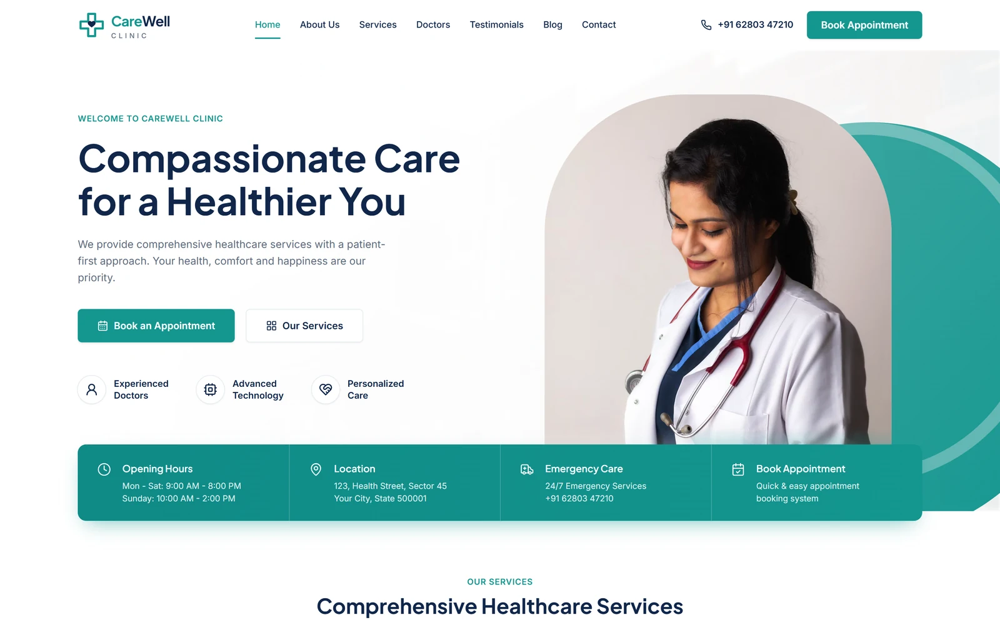
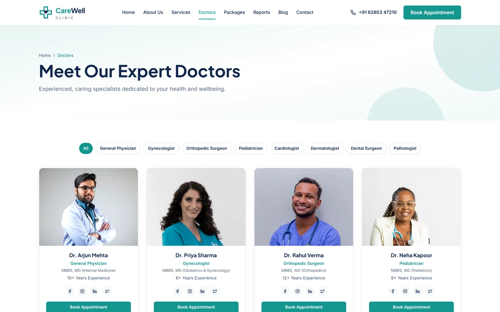
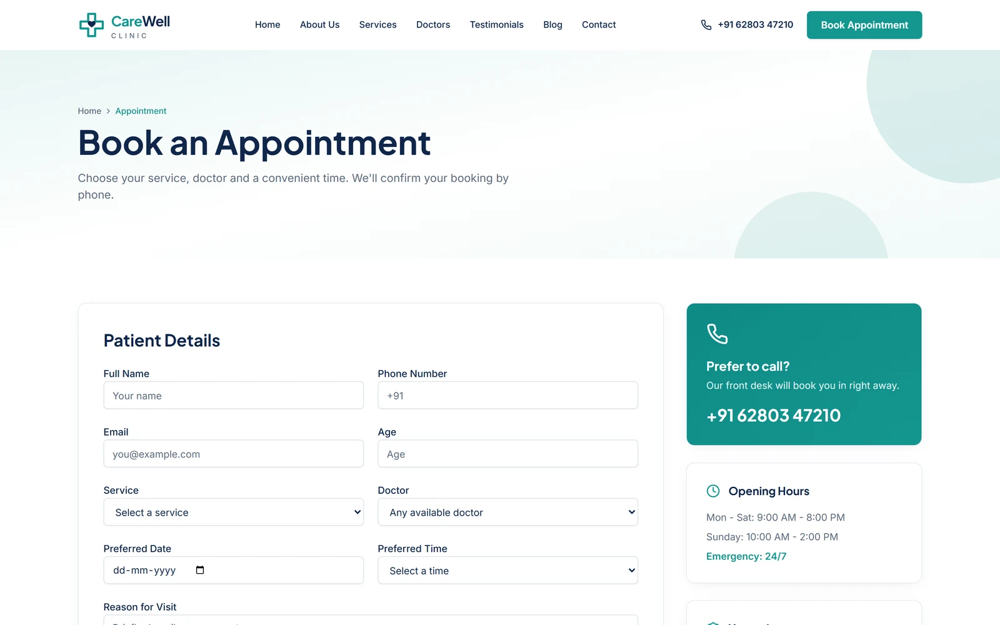

# CareWell Clinic — Clinic Website Template

A complete multi-page website for a clinic or medical practice, built with React, Vite, Tailwind CSS v4 and shadcn/ui. It includes a home page, eight service pages, a doctors directory with a speciality filter, patient testimonials, a health blog, an appointment booking form, contact, FAQs and legal pages.

**[Live demo](https://carewellclinic.codespanda.com/)** · **[Template page](https://codespanda.com/templates/carewell-clinic)** · **[Documentation](https://codespanda.com/templates/carewell-clinic/docs)**



## Features

- **12 routed pages** — Home, About, Services, a page per service, Doctors, Testimonials, Blog, a page per post, Contact, Appointment, Privacy Policy, Terms and a 404 page.
- **Doctors directory** — 8 doctors with a speciality filter, qualifications, experience and booking buttons.
- **Appointment booking** — patient details, service, doctor, preferred date and time, with a confirmation screen.
- **Health blog** — 6 articles with a listing page and individual post pages.
- **Fully responsive**, with shadcn/ui components and a calm teal design.



## Tech stack

- React 18 and JavaScript
- [Vite](https://vitejs.dev) 5
- [Tailwind CSS v4](https://tailwindcss.com) and [shadcn/ui](https://ui.shadcn.com)
- React Router 6
- [lucide-react](https://lucide.dev) icons

## Getting started

You need Node.js 20 or newer.

```bash
npm install
npm run dev
```

Open [http://localhost:5173](http://localhost:5173).

| Command | What it does |
| --- | --- |
| `npm run dev` | Start the Vite dev server |
| `npm run build` | Build the production site into `dist/` |
| `npm run preview` | Serve the built `dist/` folder locally |

## Project structure

```text
src/
  pages/            Home, About, Services, ServiceDetail, DoctorsPage, TestimonialsPage,
                    Blog, BlogPost, Contact, Appointment, Legal, NotFound
  components/
    layout/         Layout, Navbar and Footer
    sections/       Hero, InfoBar, ServicesGrid, WhyChoose, Doctors, Testimonials, CtaBanner
    ui/             shadcn/ui primitives
  data/site.js      Contact details, services, doctors, testimonials, posts, stats, FAQs
  App.jsx           Routes
  index.css         Theme colors and Tailwind setup
public/CNAME        Custom domain for GitHub Pages
```

## Make it your own

- **Content** — almost everything lives in `src/data/site.js`: contact details and hours, navigation, services, doctors, testimonials, blog posts, stats and FAQs. Service and blog pages are generated from it.
- **Photos** — they're loaded from Unsplash URLs in the `images` entries of `site.js`. Add your own photos to `public/` and point the entries at them before launch.
- **Colors** — edit the CSS variables in `:root` in `src/index.css` (the brand teal is `--primary: #14968f`). Tailwind and the shadcn/ui components pick them up.
- **Title and description** — edit `index.html`.
- **Forms** — the appointment and contact forms show a confirmation but don't send anything yet. Connect them to a form service, email API or booking system in `src/pages/Appointment.jsx` and `src/pages/Contact.jsx`.



## Deployment

`npm run build` writes a static site to `dist/`.

**GitHub Pages** — `.github/workflows/deploy.yml` builds and deploys on every push to `main`, and copies `index.html` to `404.html` so deep links like `/doctors` work.

1. In the repository, open **Settings → Pages** and set **Source** to **GitHub Actions**.
2. Push to `main`.
3. `public/CNAME` holds the custom domain. Replace it with yours, or delete it to use the default github.io address.

**Netlify, Vercel or Cloudflare Pages** — use build command `npm run build` and output folder `dist`, with a rewrite of all routes to `/index.html`.

## Credits

Designed and built by [CodesPanda](https://codespanda.com). Browse more free templates at [codespanda.com/templates](https://codespanda.com/templates).
